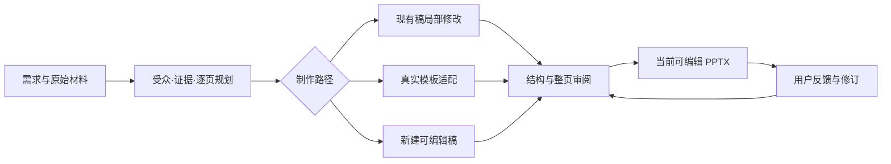

# AI PPT Studio

**把需求、资料、模板、制作和审阅串成一条可追溯的 PPT 工作流。**

AI PPT Studio 是一个面向 AI 助手与演示文稿制作者的本地工作台。它接收已有 PPT、文档和图片，支持局部修改、真实模板复用与新稿制作，输出可编辑 PowerPoint，并保留来源、修改范围和检查记录。

[English](README.en.md) · [快速开始](docs/GETTING_STARTED.md) · [真实案例](docs/SHOWCASE.md) · [系统架构](docs/ARCHITECTURE.md) · [能力与环境](docs/CAPABILITIES.md)

> 这是当前项目的公开源码快照：包含核心代码、测试、运行脚本、技能与操作文档，以及已有作品的精选预览。客户原始材料、完整任务档案、第三方模板整库和本机运行时不随仓库发布。公开范围见 [发布说明](docs/RELEASE_SCOPE.md)。

## 精选作品与版式展示

从项目长期保留的作品集中，挑选 **红金国风** 与 **科技蓝** 两组页面，展示多层图文、材质、异形构图和关系图的组织方式。图片直接取自既有作品的 PDF 导出版，保留原稿内容；来源身份与页号见 [完整案例说明](docs/SHOWCASE.md)。

### 非遗玉石 · 红金国风

统一的红金配色、纹样、书法标题与玉石图像贯穿整套作品。解决方案页把三组图文与业务流程放在同一画面，发展规划页通过连贯的金色曲线组织阶段关系。


<details>
<summary>展开看同一作品的另一种构图：发展规划</summary>


</details>

### 驾培智链 · 科技蓝

深蓝场景、发光线条和科技边框形成统一视觉。项目定位页沿曲线展开服务链，数据页通过三角关系解释教练、学员与驾校的协同。


<details>
<summary>展开看同一作品的关系图：数据驱动闭环</summary>


</details>

[查看四张完整页面与来源说明 →](docs/SHOWCASE.md)

这些是模板库中保留的既有作品集页面，用于展示设计语言和版式组织；不宣称它们由本次发布的软件版本一键生成，也不把页面内的业务陈述作为已核验的运营成果。

## 它解决什么问题

| 制作场景 | Studio 的处理方式 |
| --- | --- |
| 只改现有稿的一处内容 | 先读取页面和对象 ID，再以文件哈希绑定修改范围，保留非目标部分 |
| 按指定模板制作 | 绑定真实可编辑源文件，保留主题、母版和对象关系，明确替换文字与素材 |
| 从资料开始做新稿 | 记录受众、场合、中心信息、证据边界、逐页关系与参考选择，再进入制作 |
| 多轮修改与交付 | 使用独立 Work 包保存输入、制作源、当前输出和必要 QA，区分候选、交付与用户接受 |
| 需要检查图文和版式 | 提供结构检查、图片几何、预览、视觉差异和表达审阅接口 |
| 需要原生动画或视频 | 通过独立适配器与宿主工具处理，并分别检查静态页面、放映和视频结果 |

AI 助手负责理解需求、组织信息和判断页面效果；Studio 负责执行、约束与记录。它不是安装完成后即可自动包办所有创作判断的在线服务。

## 核心能力

- **PPTX 文件操作**：读取结构、新建空白稿、另存、选择性编辑、修订发布与回退所需的文件身份记录。
- **内容与设计规划**：面向受众建立故事线，记录逐页主张、证据和邻页逻辑；同一流程覆盖新稿和模板路线。
- **模板与素材管理**：目录检索、页面结构索引、来源哈希、页级复用、素材账本和权利处理记录。
- **可编辑制作**：HTML → PPTX、PptxGenJS 原生场景及模板适配；图片型输出明确标注为图片型。
- **审阅与验证**：结构、图片裁切、整页表达、来源关联和当前文件版本分别核验；自动检查不代替视觉判断。
- **跨平台运行**：Python 核心、Node 渲染脚本、PowerShell 与 Shell 包装器，按主机平台选择依赖。
- **可移植技能**：提供 PowerPoint 场景下的需求分流、表达审阅与交接 schema，见 [集成说明](aippt-studio/docs/CHATGPT_POWERPOINT_SKILL.md)。

## 快速开始

源码要求 **Python 3.11+**，Node 渲染链要求 **Node.js 22.12+**。以下是 macOS 使用 `uv` 的安装示例：

```sh
git clone https://github.com/kirilovamanolo490-ship-it/aippt-studio.git
cd aippt-studio/aippt-studio
uv venv .venv-macos --python 3.13
UV_PROJECT_ENVIRONMENT=.venv-macos uv sync --frozen --extra dev
npm ci --ignore-scripts
cd ..
```

查看命令并创建、检查、复制一个 PPTX：

```sh
./aippt-studio/.venv-macos/bin/aippt --help
./aippt-studio/.venv-macos/bin/aippt pptx-new ./blank.pptx
./aippt-studio/.venv-macos/bin/aippt pptx-inspect ./blank.pptx --json
./aippt-studio/.venv-macos/bin/aippt pptx-save-as ./blank.pptx --output ./copy.pptx
```

基础文件操作不需要打开 PowerPoint。预览、原生自动化、媒体导出及外部生成能力需要各自的工具和环境；安装 Python/npm 包不会自动安装这些软件。完整说明见 [开始使用](docs/GETTING_STARTED.md) 和 [平台支持](aippt-studio/docs/PLATFORM_SUPPORT.md)。

## 从需求到交付



原生 PowerPoint 放映和视频检查按任务需要执行。静态图片只能说明页面预览；生成成功、检查通过、交付与用户接受是不同状态。

## 仓库结构

```text
.
├── README.md / README.en.md   项目介绍
├── docs/                     公开指南、案例与发布范围
│   └── assets/               真实作品精选页
├── .agents/skills/           AI 助手的工作流程入口
├── scripts/                  Work 与运行时、库索引工具
└── aippt-studio/
    ├── src/aippt_studio/      Python CLI 与核心模块
    ├── node/                 渲染、模板、预览与媒体脚本
    ├── tests/                回归测试源码
    ├── integrations/         PowerPoint 技能与 schema
    ├── scripts/              适配器和安装/检查工具
    ├── docs/                 操作合同与技术说明
    ├── examples/ / samples/  小型示例
    └── *lock*                依赖版本和上游来源目录
```

Work、模板库和上游源码目录按需在本机建立。公开仓库不包含历史 Work，也不需要先下载历史任务才能阅读或使用核心代码。

## 开发与验证

```sh
# 在仓库根目录，已完成 macOS Python 环境安装后
./aippt-studio/.venv-macos/bin/python -m pytest -p no:cacheprovider \
  aippt-studio/tests/test_pptx_file_ops.py \
  aippt-studio/tests/test_pptx_edit.py \
  aippt-studio/tests/test_image_geometry.py
```

完整测试可通过 `scripts/pwsh.sh` 调用 `aippt-studio/scripts/test.ps1`；跨平台包装器需要 PowerShell 7.3+。部分测试或功能涉及外部工具，环境条件以各自检查结果为准。本次公开快照的检查范围见 [验证记录](docs/VALIDATION.md)。

## 文档导航

| 想了解什么 | 从这里开始 |
| --- | --- |
| 安装与最小运行 | [GETTING_STARTED](docs/GETTING_STARTED.md) |
| 模块职责与数据流 | [ARCHITECTURE](docs/ARCHITECTURE.md) |
| 能力和外部依赖 | [CAPABILITIES](docs/CAPABILITIES.md) |
| 制作路径 | [AUTHORING_ENTRYPOINTS](aippt-studio/docs/AUTHORING_ENTRYPOINTS.md) |
| 局部修改 | [QUICK_REVISIONS](aippt-studio/docs/QUICK_REVISIONS.md) |
| 真实模板复用 | [TEMPLATE_FIRST_WORKFLOW](aippt-studio/docs/TEMPLATE_FIRST_WORKFLOW.md) |
| 表达质量 | [PRESENTATION_QUALITY](aippt-studio/docs/PRESENTATION_QUALITY.md) |
| 案例与公开范围 | [SHOWCASE](docs/SHOWCASE.md) · [RELEASE_SCOPE](docs/RELEASE_SCOPE.md) |

## 使用与贡献

欢迎通过 Issue 说明可复现的问题、使用环境、预期结果和最小示例。提交材料前请移除客户姓名、联系方式、密钥和未授权素材。代码贡献请附与改动相关的验证结果，见 [CONTRIBUTING](CONTRIBUTING.md)。

本次发布尚未为项目原创代码选定通用开源许可证；公开可见不等于授予任意再分发或商用权利。第三方代码保留自身许可，案例图片用于作品展示，详见 [NOTICE](NOTICE.md) 与 [第三方说明](docs/THIRD_PARTY.md)。
