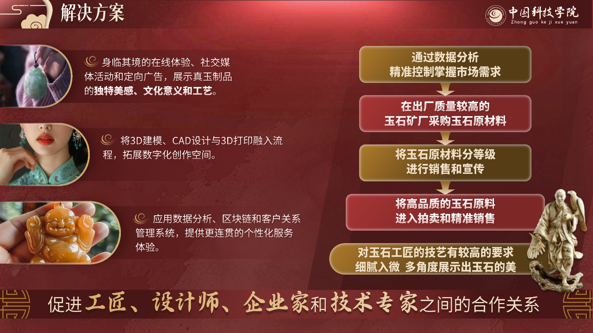
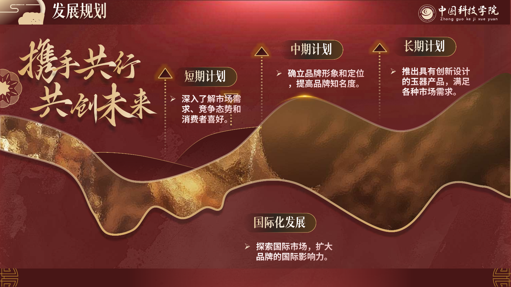
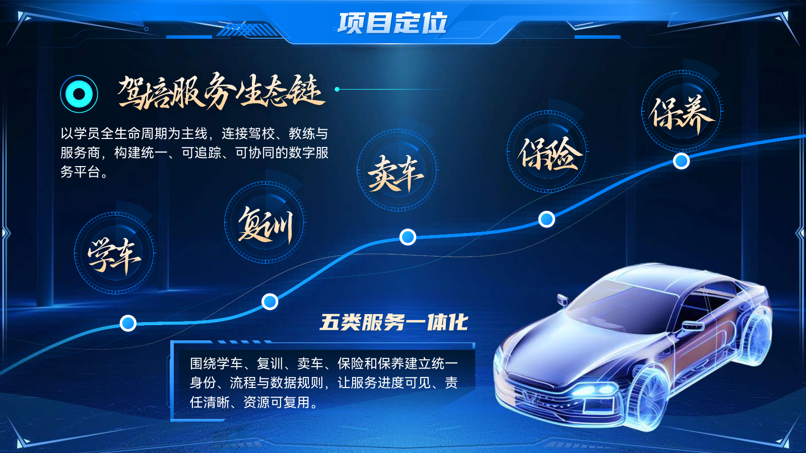
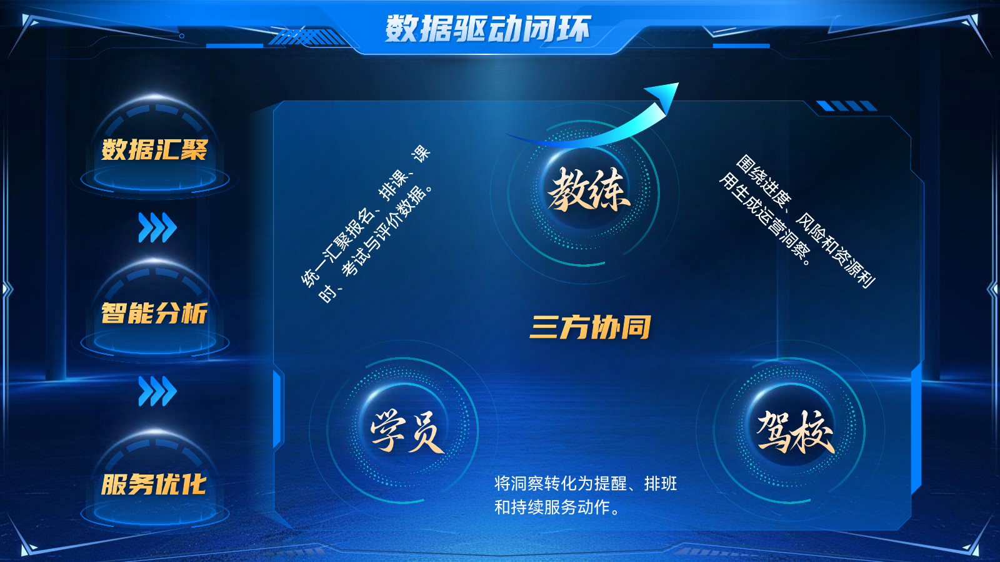

# 精选作品：红金国风与科技蓝

本页挑选项目模板库中长期保留的两组作品集页面，展示完整的设计语言、丰富的图文关系和有变化的构图。四张图片从既有 PDF 导出版直接渲染，没有为此次发布重写页面或生成新的效果图。

来源文件与作品集迁移记录进行指纹核对；公开清单见 [showcase-manifest.json](showcase-manifest.json)。这里展示的是既有作品，不把它们说成本次软件版本一键生成的结果。

## 非遗玉石数字化传播与文创转化方案

**14 页既有作品；精选第 7、14 页。**

红金背景、纹样、玉石图像、书法标题和金属质感组成统一视觉。选页关注同一套风格如何承载不同内容关系，而不是重复同一种卡片。

### 第 7 页 · 解决方案

左侧以三组图片与说明建立应用场景，右侧用纵向流程表达原料、分级与销售的关系。底部的大标题把两部分重新合成一条协作主张。

### 第 14 页 · 发展规划

以连续的金色曲线贯穿阶段，用标题、指示线和文字区形成不同层级。背景材质与曲线造型延续整套作品的文化主题。

## 驾培智链 · 数字化运营协同平台

**8 页既有作品；精选第 3、5 页。**

深蓝背景、科技边框、发光线条和强调色统一整套页面。不同内容分别采用沿线展开与三角关系构图。

### 第 3 页 · 项目定位

将学车、复训、卖车、保险和保养沿曲线展开，以汽车视觉强化主题，同时为项目定位和服务规则保留独立阅读区。

### 第 5 页 · 数据驱动闭环

左侧用纵向步骤表现数据汇聚、分析和服务优化，右侧用教练、学员和驾校的三角关系表达协同。

## 来源与展示边界

这两组文件在作品集迁移清单中登记为 `portfolio_deliverable`；后来按用途归入模板库。保留位置不改变其真实身份，也不自动授予第三方模板、照片、Logo 或字体的再分发许可。

公开的是精选静态页图及来源指纹，完整 PPTX、PDF、客户材料、字体和模板整库不随仓库分发。页内产品、机构与业务文字保留原稿表达，展示不构成相关机构背书、效果承诺或当前统计事实认证。静态图不证明动画播放或原生 PowerPoint 的全部显示效果。

这次筛选仅用于优化 GitHub 项目的展示面，不改变原作品内容或任务验收状态。使用与权利说明见 [NOTICE](../NOTICE.md)。
